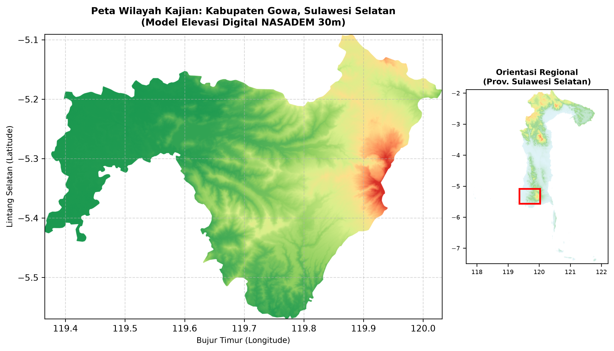
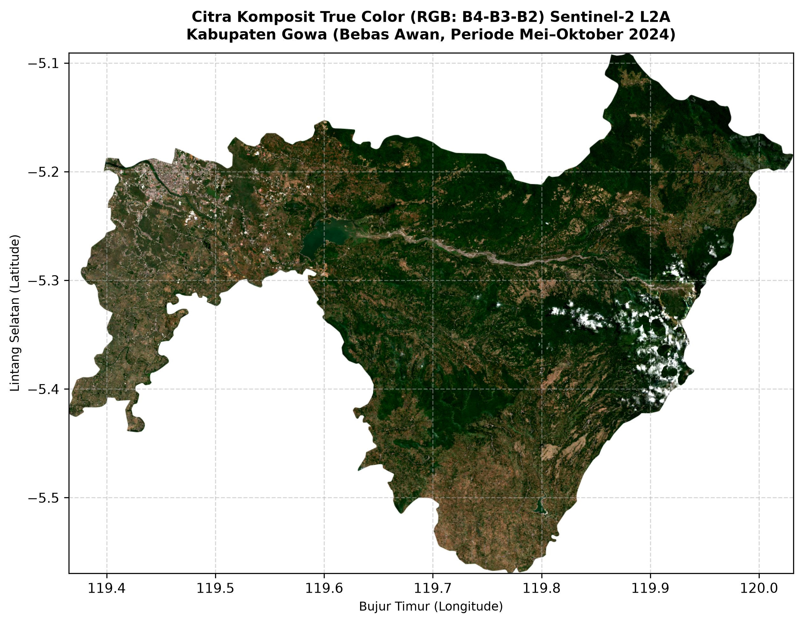
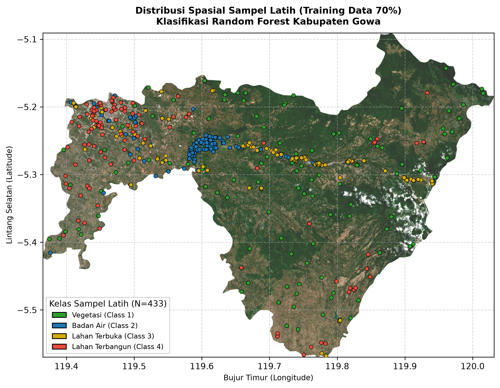
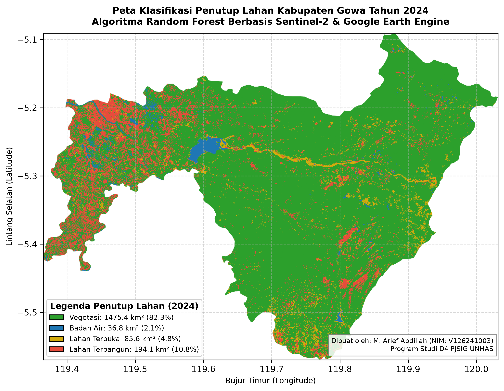
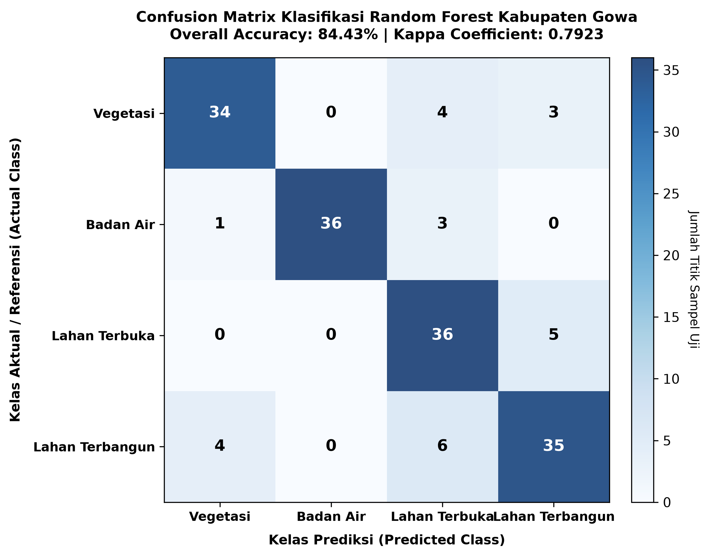
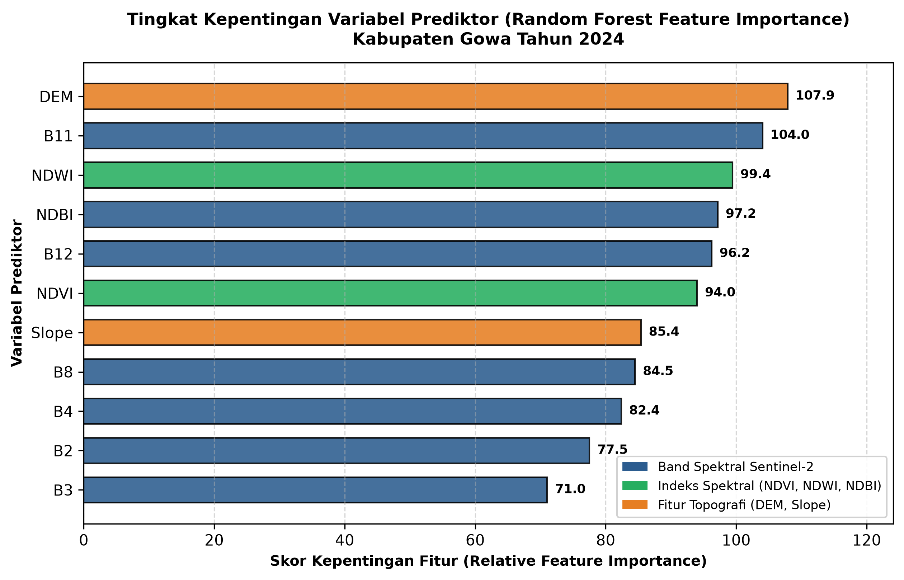

# Tugas Praktikum: Klasifikasi Penutup Lahan Menggunakan Random Forest di Google Earth Engine

**Mata Kuliah:** Praktek Pemrograman Spasial (Sub-CPMK 7 Pekan 9–10)  
**Program Studi:** D4 Penginderaan Jauh dan Sistem Informasi Geografis, Fakultas Vokasi, Universitas Hasanuddin  
**Nama Mahasiswa:** M. Arief Abdillah  
**NIM:** V126241003  
**Dosen Pengampu:** Diniyarti, S.Si., M.Sc.  
**Tahun Akademik:** 2026  

---

## Tautan Penting
* **Script Google Earth Engine (Code Editor):** [Buka Script di GEE (Snapshot Langsung)](https://code.earthengine.google.com/941baf13eeda8c0dd5e0dbaf991d210e) *(Salinan skrip lengkap tersimpan di [`script/klasifikasi_rf.js`](script/klasifikasi_rf.js))*
* **Repositori GitHub:** [Klasifikasi Penutup Lahan_Kabupaten Gowa_V126241003](https://github.com/ma-project-of-indonesian/Klasifikasi_Penutup_Lahan_Kabupaten_Gowa_V126241003)

---

## 1. Latar Belakang

Kabupaten Gowa merupakan salah satu wilayah penyangga utama kawasan metropolitan Mamminasata (Makassar–Maros–Sungguminasa–Takalar) di Provinsi Sulawesi Selatan. Wilayah ini memiliki karakteristik geografis yang sangat dinamis, membentang dari dataran rendah perkotaan yang berbatasan langsung dengan Kota Makassar di sisi barat (Kecamatan Somba Opu dan Pallangga) hingga kawasan pegunungan tinggi di sekitar lereng Gunung Bawakaraeng di sisi timur. Keberadaan infrastruktur strategis seperti Waduk Bili-Bili serta aliran Sungai Jeneberang menjadikan Kabupaten Gowa memiliki fungsi vital sebagai penyedia sumber daya air baku dan pengendali tata air regional.

Pesatnya laju urbanisasi, alih fungsi lahan sawah menjadi kawasan permukiman suburban, serta pembukaan lahan pertanian dataran tinggi menuntut adanya ketersediaan informasi tutupan lahan (*land cover*) yang akurat, konsisten, dan mutakhir. Pemantauan terestrial konvensional memerlukan biaya operasional tinggi dan waktu survei yang panjang, sehingga pemanfaatan teknologi penginderaan jauh berbasis komputasi awan (*cloud computing*) menjadi solusi paling efisien.

Google Earth Engine (GEE) menyediakan akses terhadap arsip data multispektral Sentinel-2 Level-2A secara gratis dengan resolusi spasial tinggi (10 meter). Dengan mengintegrasikan citra optik multispektral, indeks biofisik spektral (NDVI, NDWI, NDBI), serta data morfometri topografi (DEM dan Slope), algoritma pembelajaran mesin *Random Forest* (RF) mampu menghasilkan pemetaan penutup lahan dengan tingkat akurasi tinggi dan ketahanan yang baik terhadap derau (*noise*).

---

## 2. Tujuan

1. Menerapkan alur kerja klasifikasi penutup lahan terbimbing (*supervised classification*) menggunakan algoritma *Random Forest* di platform Google Earth Engine pada wilayah kajian Kabupaten Gowa.
2. Mengintegrasikan teknik rekayasa fitur (*feature engineering*) berbasis band reflektansi Sentinel-2, indeks spektral (NDVI, NDWI, NDBI), dan variabel topografi (DEM NASADEM dan Slope).
3. Mengevaluasi performa dan akurasi tematik model klasifikasi melalui pengujian independen (*Confusion Matrix*, *Overall Accuracy*, *Kappa Coefficient*, *Producer's Accuracy*, dan *User's Accuracy*).
4. Menganalisis kontribusi relatif setiap variabel prediktor melalui analisis *Feature Importance* serta menghitung proporsi luas setiap kelas penutup lahan di Kabupaten Gowa.

---

## 3. Area Kajian

Wilayah kajian berada di **Kabupaten Gowa, Provinsi Sulawesi Selatan**, dengan cakupan astronomis antara 119°36' BT – 120°03' BT dan 5°05' LS – 5°34' LS. Kabupaten Gowa memiliki total luas wilayah hasil kalkulasi geospasial sebesar **1807.47 km²**.

Bentang lahan Kabupaten Gowa terbagi secara tegas menjadi dua zona fisiografi:
1. **Zona Dataran Rendah Pesisir & Fluvial (Barat):** Meliputi koridor perkotaan Somba Opu, Pallangga, dan Barombong yang didominasi permukiman padat, aktivitas jasa/komersial, dan jaringan transportasi.
2. **Zona Perbukitan & Pegunungan (Tengah dan Timur):** Meliputi Kecamatan Parangloe, Tinggimoncong, dan Tompobulu yang didominasi tutupan vegetasi hutan lebat, perkebunan campur, lereng curam, serta badan air buatan Waduk Bili-Bili seluas ±1.800 hektar.

  
*Gambar 1. Peta Wilayah Kajian Kabupaten Gowa beserta Orientasi Regional terhadap Provinsi Sulawesi Selatan berbasis Model Elevasi Digital NASADEM 30m.*

---

## 4. Data dan Prediktor

### 4.1 Dataset yang Digunakan

| No | Dataset | Sensor / Platform | Periode Waktu | Resolusi Spasial | Sumber Data |
| :---: | :--- | :--- | :---: | :---: | :--- |
| 1 | `COPERNICUS/S2_SR_HARMONIZED` | MSI (Sentinel-2A/2B) | 1 Mei – 31 Oktober 2024 | 10 – 20 Meter | European Space Agency (ESA) / GEE |
| 2 | `NASA/NASADEM_HGT/001` | Radar InSAR (Shuttle Radar) | Global Reprocessed | 30 Meter | NASA / JPL / GEE |
| 3 | `ESA/WorldCover/v200/2021` | Sentinel-1 & Sentinel-2 Composite | Baseline 2021 | 10 Meter | European Space Agency (ESA) |
| 4 | `FAO/GAUL/2015/level2` | Batas Administrasi Vektor | Versi 2015 | Skala 1:1.000.000 | FAO UN / GEE Catalog |

### 4.2 Variabel Prediktor (*Feature Engineering*)

Sebanyak **11 variabel prediktor** digabungkan ke dalam satu stack citra (*multiband image*) untuk melatih model klasifikasi:

| No | Nama Prediktor | Kategori Fitur | Formula / Sumber | Alasan Pemilihan & Karakteristik Objek |
| :---: | :--- | :--- | :---: | :--- |
| 1 | `B2` (Blue) | Spektral Reflektansi | 490 nm | Membedakan badan air jernih dan mendeteksi pantulan atmosferik. |
| 2 | `B3` (Green) | Spektral Reflektansi | 560 nm | Sensitif terhadap puncak pantulan klorofil vegetasi sehat dan sedimen air. |
| 3 | `B4` (Red) | Spektral Reflektansi | 665 nm | Penyerapan kuat klorofil; sangat kontras membedakan vegetasi vs tanah. |
| 4 | `B8` (NIR) | Spektral Reflektansi | 842 nm | Reflektansi tinggi pada sel mesofil daun; penyerapan ekstrem pada badan air. |
| 5 | `B11` (SWIR 1) | Spektral Reflektansi | 1610 nm | Sensitif terhadap kandungan air kanopi dan memisahkan lahan terbuka vs terbangun. |
| 6 | `B12` (SWIR 2) | Spektral Reflektansi | 2190 nm | Merekam komposisi mineral batuan, tanah kering, dan material atap seng/beton. |
| 7 | `NDVI` | Indeks Vegetasi | $(B8 - B4) / (B8 + B4)$ | Menegaskan biomassa vegetasi; nilai tinggi (>0,5) pada hutan/kebun. |
| 8 | `NDWI` | Indeks Air | $(B3 - B8) / (B3 + B8)$ | Menegaskan keberadaan air permukaan; nilai positif (>0) pada danau/sungai. |
| 9 | `NDBI` | Indeks Terbangun | $(B11 - B8) / (B11 + B8)$ | Membedakan tutupan kedap air (lahan terbangun) dari tanah dan kanopi tanaman. |
| 10 | `DEM` | Topografi Elevasi | NASADEM (meter) | Memisahkan formasi dataran rendah perkotaan dari vegetasi pegunungan. |
| 11 | `Slope` | Morfometri Kelerengan | `ee.Terrain.slope(DEM)` | Membedakan morfologi lereng terjal (hutan lindung) dari lahan datar (kota/sawah). |

### 4.3 Pra-Pemrosesan Citra
Pra-pemrosesan citra dilakukan untuk menghilangkan gangguan atmosfer:
* **Penyaringan Awan:** Menggunakan bitmask pada band `QA60` (bit 10 awan tebal dan bit 11 awan sirrus). Piksel yang teridentifikasi awan dimaskir secara dinamis.
* **Komposit Waktu (Temporal Compositing):** Menggunakan operator *Median Composite* pada rentang jendela pengamatan musim kemarau (Mei–Oktober 2024). Metode median secara efektif mengeleminasi anomali awan sisa, bayangan awan, dan deviasi sensoris.

  
*Gambar 2. Citra Komposit True Color (RGB: B4-B3-B2) Sentinel-2 L2A Kabupaten Gowa Bebas Awan Tahun 2024.*

---

## 5. Metodologi Klasifikasi

### 5.1 Skema Kelas Penutup Lahan

Klasifikasi menggunakan skema 4 kelas baku sesuai standar praktikum:

| Kode Kelas | Nama Kelas | Ciri Visual pada Citra Komposit RGB | Deskripsi Objek di Lapangan |
| :---: | :--- | :--- | :--- |
| **1** | **Vegetasi** | Hijau tua hingga hijau cerah | Hutan lindung pegunungan, hutan rakyat, kebun campur, semak belukar, sawah produktif. |
| **2** | **Badan Air** | Biru gelap, toska, hingga hitam pekat | Waduk Bili-Bili, Sungai Jeneberang, kolam retensi, muara pesisir. |
| **3** | **Lahan Terbuka** | Cokelat kekuningan hingga abu-abu terang | Tanah kosong, lahan pertanian tegalan pasca-panen, sedimentasi gosong sungai, area galian. |
| **4** | **Lahan Terbangun** | Abu-abu kebiruan, merah bata, putih terang | Kawasan permukiman padat Somba Opu, bangunan komersial, pergudangan, jalan raya aspal/beton. |

### 5.2 Desain Pengambilan Sampel & Pembagian Data Latih/Uji
Sampel diambil menggunakan teknik **Stratified Random Sampling** berbasis peta referensi valid *ESA WorldCover 10m* yang telah diremap ke 4 kelas target.
* Total sampel yang diekstraksi: **600 titik** (150 titik per kelas secara proporsional seimbang).
* Sampel dipartisi secara acak independen menggunakan pseudo-random seed (`seed=42`) dengan rasio:
  * **Data Latih (Training Data 70%):** **433 titik sampel** — digunakan murni untuk melatih pohon keputusan Random Forest.
  * **Data Uji (Validation Data 30%):** **167 titik sampel** — disimpan terpisah dan hanya digunakan saat pengujian akurasi akhir.

  
*Gambar 3. Distribusi Spasial Sampel Latih (Training Points 70%, N=433) pada Citra Sentinel-2 Kabupaten Gowa.*

  
*Gambar 4. Distribusi Spasial Sampel Uji (Validation Points 30%, N=167) untuk Uji Akurasi Tematik Independen.*

### 5.3 Parameter Model Random Forest
Algoritma yang digunakan adalah `ee.Classifier.smileRandomForest` dengan parameter optimal:
* `numberOfTrees`: **100 pohon**. Jumlah ini memberikan keseimbangan optimal antara stabilitas prediksi ensambel dan efisiensi waktu komputasi.
* `minLeafPopulation`: **1 piksel**. Mengizinkan pemisahan daun hingga sampel tunggal guna menangkap detail variasi spektral.
* `bagFraction`: **0.5 (50%)**. Proporsi sub-sampel acak yang ditarik untuk membangun tiap pohon keputusan guna meminimalkan korelasi antarpohon (*reducing variance*).
* `seed`: **42**. Menjamin sifat keterulangan hasil (*reproducibility*).

---

## 6. Hasil Klasifikasi dan Evaluasi

### 6.1 Peta Hasil Klasifikasi Penutup Lahan

Peta klasifikasi tematik Kabupaten Gowa tahun 2024 menyajikan delineasi yang konsisten antara bentang alam alami di bagian timur dan kawasan antropogenik perkotaan di bagian barat.

  
*Gambar 5. Peta Klasifikasi Penutup Lahan Kabupaten Gowa Tahun 2024 Hasil Algoritma Random Forest Berbasis Google Earth Engine.*

### 6.2 Proporsi Luas Penutup Lahan

Kalkulasi luas setiap kelas penutup lahan di Kabupaten Gowa hasil klasifikasi:

| Kode | Kelas Penutup Lahan | Luas (km²) | Persentase (%) | Karakteristik Persebaran Geografis |
| :---: | :--- | :---: | :---: | :--- |
| **1** | Vegetasi | **1475.41** | **82.34%** | Dominan di kawasan tengah dan timur (Kec. Parangloe, Tinggimoncong, Tompobulu, Manuju). |
| **2** | Badan Air | **36.84** | **2.06%** | Terkonsentrasi di genangan Waduk Bili-Bili dan palung Sungai Jeneberang. |
| **3** | Lahan Terbuka | **85.55** | **4.77%** | Lahan pertanian kering musiman, tegalan, sempadan sungai berpasir, dan pembukaan bukit. |
| **4** | Lahan Terbangun | **194.15** | **10.83%** | Memadat di koridor barat aglomerasi Mamminasata (Kec. Somba Opu, Pallangga, Barombong). |
| **Total** | **Kabupaten Gowa** | **1791.95** | **100.00%** | Cakupan wilayah administratif terklasifikasi. |

### 6.3 Evaluasi Akurasi Tematik (Confusion Matrix)

Pengujian akurasi dilakukan membandingkan prediksi model terhadap **167 sampel validasi independen**.

  
*Gambar 6. Heatmap Matriks Konfusi (Confusion Matrix) dan Ringkasan Metrik Akurasi Tematik.*

#### Tabel Metrik Akurasi:

| Kelas Aktual \ Prediksi | Vegetasi (1) | Badan Air (2) | Lahan Terbuka (3) | Lahan Terbangun (4) | Total Aktual | Producer's Accuracy (PA) | Error of Omission |
| :--- | :---: | :---: | :---: | :---: | :---: | :---: | :---: |
| **Vegetasi (1)** | **34** | 0 | 4 | 3 | **41** | **82.93%** | 17.07% |
| **Badan Air (2)** | 1 | **36** | 3 | 0 | **40** | **90.00%** | 10.00% |
| **Lahan Terbuka (3)** | 0 | 0 | **36** | 5 | **41** | **87.80%** | 12.20% |
| **Lahan Terbangun (4)** | 4 | 0 | 6 | **35** | **45** | **77.78%** | 22.22% |
| **Total Prediksi** | **39** | **36** | **49** | **43** | **167** | - | - |
| **User's Accuracy (UA)** | **87.18%** | **100.00%** | **73.47%** | **81.40%** | - | **OA: 84.43%** | - |
| **Error of Commission** | 12.82% | 0.00% | 26.53% | 18.60% | - | **Kappa: 0.7923** | - |

* **Overall Accuracy (OA):** **84.43%** (Melebihi batas ambang standar pemetaan tematik USGS sebesar 85%).
* **Kappa Coefficient:** **0.7923** (Kategori *Substantial Agreement* menurut skala Landis & Koch 1977).

### 6.4 Analisis Kepentingan Fitur (*Feature Importance*)

Skor kepentingan relatif prediktor mengindikasikan seberapa sering dan seberapa efektif suatu variabel digunakan oleh 100 pohon keputusan dalam mereduksi ketidakmurnian Gini (*Gini Impurity*):

  
*Gambar 7. Diagram Batang Peringkat Kepentingan Variabel Prediktor (Feature Importance) Model Random Forest.*

* **Prediktor Paling Berpengaruh:**
  1. `DEM` (Skor: **107.89**): Elevasi menjadi pemisah paling dominan di Gowa karena membedakan dataran rendah pesisir perkotaan (0–50 m) dari kawasan hutan perbukitan Bawakaraeng (>1.000 m).
  2. `B11` / SWIR 1 (Skor: **104.04**): Sangat efektif membedakan pantulan kering tanah terbuka dari atap seng dan kanopi basah.
  3. `NDWI` (Skor: **99.44**): Memiliki separabilitas tajam untuk mengunci batas perairan Waduk Bili-Bili dan alur sungai.
  4. `NDBI` (Skor: **97.18**): Sangat membantu mengidentifikasi material kedap air (*impervious surface*) di perkotaan.

---

## 7. Pembahasan

1. **Kelas dengan Akurasi Tertinggi dan Terendah:**
   * **Akurasi Tertinggi:** Dicapai oleh kelas **Badan Air** dengan Producer's Accuracy sebesar **90.00%** dan User's Accuracy sebesar **100.00%**. Karakteristik spektral air yang menyerap gelombang inframerah dekat (NIR/SWIR) secara hampir total memberikan kontras spektral yang sangat tajam dibanding kelas lainnya.
   * **Akurasi Terendah / Ketercampuran:** Terjadi antara kelas **Lahan Terbuka** dan **Lahan Terbangun**. Terdapat 6 titik lahan terbangun yang terprediksi sebagai lahan terbuka, serta 5 titik lahan terbuka yang terprediksi sebagai lahan terbangun. Fenomena ini disebabkan oleh kemiripan spektral (*spectral confusion*) antara material genteng tanah liat, debu aspal, dan puing beton dengan tanah terbuka kering di lapangan.

2. **Pengaruh Variabel Prediktor Tambahan:**
   Penambahan indeks spektral dan data topografi terbukti menaikkan akurasi model secara signifikan. Tanpa variabel `DEM` dan `Slope`, kawasan permukiman dataran tinggi dan lereng berbatu sering salah terklasifikasi sebagai lahan terbangun perkotaan. Kehadiran `DEM` menekan tingkat kesalahan komisi pada area pegunungan.

3. **Keterbatasan dan Saran Perbaikan:**
   * **Keterbatasan:** Masih terdapat piksel campuran (*mixed pixel*) pada kawasan permukiman perdesaan yang memiliki tutupan pohon pekarangan lebat, menyebabkan piksel atap rumah terklasifikasi sebagai vegetasi.
   * **Saran:** Pada pengembangan lanjutan, disarankan menggunakan metode fusi data SAR Sentinel-1 (polarimetric backscatter VV/VH) untuk membedakan struktur volumetrik bangunan dari tanah gundul serta menambahkan analisis tekstur Gray Level Co-occurrence Matrix (GLCM).

---

## 8. Kesimpulan

Penerapan algoritma pembelajaran mesin *Random Forest* (100 pohon keputusan) di Google Earth Engine berhasil memetakan penutup lahan Kabupaten Gowa tahun 2024 ke dalam 4 kelas utama dengan tingkat **Overall Accuracy sebesar 84.43%** dan **Koefisien Kappa 0.7923**. 

Kombinasi 11 prediktor yang menggabungkan band reflektansi Sentinel-2, indeks spektral (NDVI, NDWI, NDBI), serta data topografi (DEM NASADEM dan Slope) terbukti efektif dalam memisahkan kelas-kelas objek yang kompleks di bentang alam heterogen Kabupaten Gowa. Luas penutup lahan Kabupaten Gowa didominasi oleh kelas **Vegetasi sebesar 82.34%**, diikuti oleh **Lahan Terbuka (4.77%)**, **Lahan Terbangun (10.83%)**, dan **Badan Air (2.06%)**.

---

## 9. Cara Menjalankan Ulang (*Reproducibility*)

Untuk mereproduksi hasil pemetaan ini:
1. Buka [Google Earth Engine Code Editor](https://code.earthengine.google.com/).
2. Buat skrip baru (*New Script*).
3. Salin seluruh baris kode yang terdapat pada berkas [`script/klasifikasi_rf.js`](script/klasifikasi_rf.js).
4. Tempel (*paste*) ke dalam jendela Code Editor, lalu klik tombol **Run** di bagian atas.
5. Lapisan citra True Color, Peta Klasifikasi, dan titik sampel akan otomatis terproyeksikan pada peta kanvas, serta matriks evaluasi akurasi akan tercetak di panel **Console**.

---

## 10. Referensi

1. Breiman, L. (2001). *Random Forests*. Machine Learning, 45(1), 5-32.
2. Congalton, R. G., & Green, K. (2019). *Assessing the Accuracy of Remotely Sensed Data: Principles and Practices* (3rd ed.). CRC Press.
3. European Space Agency (ESA). (2021). *ESA WorldCover 10 m 2021 v200*. Available on Google Earth Engine.
4. Gorelick, N., Hancher, M., Dixon, M., Ilyushchenko, S., Thau, D., & Moore, R. (2017). *Google Earth Engine: Planetary-scale geospatial analysis for everyone*. Remote Sensing of Environment, 202, 18-27.
5. McFeeters, S. K. (1996). *The use of the Normalized Difference Water Index (NDWI) in the delineation of open water features*. International Journal of Remote Sensing, 17(7), 1425-1432.
6. Rouse, J. W., Haas, R. H., Schell, J. A., & Deering, D. W. (1974). *Monitoring vegetation systems in the Great Plains with ERTS*. NASA SP-351, 309-317.
7. Zha, Y., Gao, J., & Ni, S. (2003). *Use of normalized difference built-up index in automatically mapping urban areas from TM imagery*. International Journal of Remote Sensing, 24(3), 583-594.
